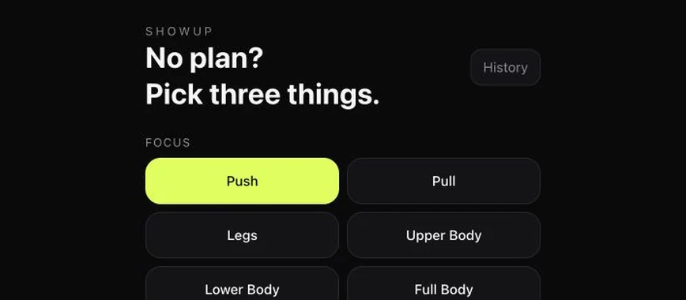

# Noor (Deen) Alseginy

I lead enterprise risk data platform work at **Bank of America**. I've also built and sold operational systems for law firms, personally closing **$3M+ ARR** through solution builds and paid trials.

My work spans customer discovery, solution design and delivery. I stay hands-on with Python, SQL and integrations.

[Portfolio](https://alseginy.com/) · [LinkedIn](https://www.linkedin.com/in/nooralseginy/) · [Contact](mailto:noor@alseginy.com)

## Selected professional work

### Enterprise risk data platform
**Bank of America · In use by 15+ teams**

Built the platform without dedicated funding and earned executive buy-in through discovery and MVP demos. Adoption reached 15+ teams, two years ahead of forecast. I now lead four analysts and the platform roadmap.

[Read the platform story →](https://alseginy.com/work/enterprise-platform.html)

### Refund review workflow
**Legal tech · In production across 13 attorney accounts**

Built a browser-automation pipeline that checks refund eligibility, consults CRM notes and flags uncertain cases for human review. The walkthrough follows sample records through those decisions.

[Follow a refund decision →](https://alseginy.com/work/refund-review.html)

## Featured personal build: SHOWUP

A workout planner for walking into the gym with limited time and no plan. It generates sessions around your equipment and experience, lets you log each set, and keeps session history in your browser.

**Next.js · TypeScript · Local browser storage**

[Try the live app →](https://showup-sigma.vercel.app) · [Inspect the source →](https://github.com/nooralseginy/SHOWUP)

## Further work

- **[Airflow orchestration](https://alseginy.com/work/airflow-lab.html):** A technical demonstration I built for my Astronomer sales engineering interview process. Includes scheduling decisions, sample code and explicit execution limits.
- **[Sprain.AI](https://github.com/nooralseginy/Sprain-AI):** An educational rehab tracker with predefined protocols, progress scoring and a photo log stored in the browser. [Live app →](https://sprain-ai.vercel.app)
